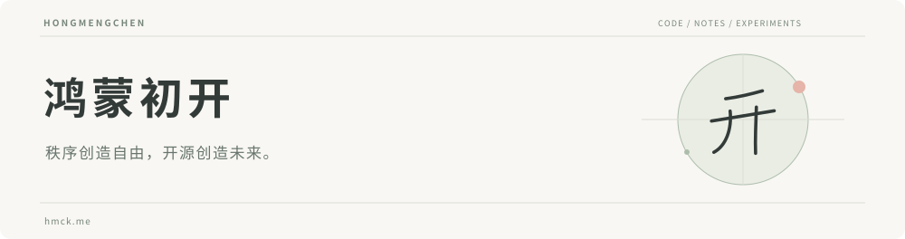

<picture>
  <source media="(prefers-color-scheme: dark)" srcset="assets/header-dark.svg">
  <source media="(prefers-color-scheme: light)" srcset="assets/header-light.svg">
  
</picture>

  <a href="https://hmck.me/">个人网站</a> ·
  <a href="https://hmck.me/blog">技术博客</a> ·
  <a href="https://hmck.me/insights">思考与记录</a> ·
  <a href="https://hmck.me/game">小实验</a>

### 你好，我是亮。

这里是我的代码与实践记录。关注 **内容工程、开源协作与长期主义**。

在项目里实践，在写作里整理。希望让记录能够被重新使用，让方法和工具在开放协作中不断完善。

### 公开项目

| 项目 | 内容 | 技术 |
| :--- | :--- | :--- |
| **[hy-health](https://github.com/hongmengchen/hy-health)** | 智慧数字医疗应用系统，包含医师、药品与材料管理 | Java · Spring Boot · Vue |
| **[OpenCloudDisk](https://github.com/hongmengchen/OpenCloudDisk)** | 共享云盘项目 | Spring MVC · MyBatis Plus · MySQL |
| **[Endless Realm](https://github.com/hongmengchen/Endless-Realm)** | 社交平台实践，包含动态、评论与用户管理 | Java · Vue · Element Plus |

### 写作与实验

- [技术文档，是学习与协作的导航](https://hmck.me/insights/documentation-as-navigation)
- [知识管理的起点，是让记录重新被使用](https://hmck.me/insights/notes-for-reuse)
- [从笔记到表达：我的学习与协作思考精选](https://hmck.me/insights/learning-and-expression)
- 换个节奏：[2048](https://hmck.me/game/2048) · [贪吃蛇](https://hmck.me/game/snake) · [井字棋](https://hmck.me/game/tictactoe) · [五子棋](https://hmck.me/game/gomoku)

---

秩序创造自由，开源创造未来。

